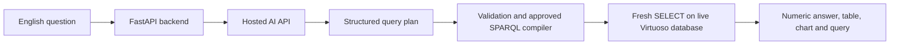

# Hosted AI: English to live SPARQL

Ask UniStats uses a hosted AI API. This workspace is configured and tested with **Gemini 3.5 Flash-Lite**. No local model is required. Python constructs and executes the SPARQL and calculates the numeric answer from database rows. Real-provider and live-database results are in [AI_VALIDATION.md](AI_VALIDATION.md).

## 1. Current Gemini connection and provider configuration

Your private `.env` contains the supplied key and these non-secret settings:

```dotenv
UNISTATS_AI_BASE_URL=https://generativelanguage.googleapis.com/v1beta/openai
UNISTATS_AI_MODEL=gemini-3.5-flash-lite
UNISTATS_AI_RESPONSE_FORMAT=json_schema
UNISTATS_AI_TOKEN_PARAMETER=max_completion_tokens
```

Gemini uses the existing adapter through [Google's compatibility endpoint](https://ai.google.dev/gemini-api/docs/openai). For a fresh checkout, copy the template once from `unistats-app` (do not overwrite an existing credentials file):

```powershell
if (-not (Test-Path -LiteralPath .env)) { Copy-Item -LiteralPath .env.example -Destination .env }
```

Edit these three values in `.env`:

```dotenv
UNISTATS_AI_API_KEY=your-provider-key
UNISTATS_AI_BASE_URL=https://your-provider.example/v1
UNISTATS_AI_MODEL=your-provider-model-id
```

The URL above is a placeholder. Use the provider's actual HTTPS **API base URL**, including its version/path prefix, without `/chat/completions`. The backend appends that path and authenticates with `Authorization: Bearer <key>`. For the OpenAI service the base URL is `https://api.openai.com/v1`; choose a supported model from your own account. Other providers must implement the compatible Chat Completions protocol. Native Anthropic, native Gemini, Responses-only endpoints, and services needing custom authentication headers are not supported by this adapter.

The key belongs only in the backend environment or `.env`, never HTML or JavaScript. `.env` is ignored by Git and is outside the served `public/` directory. The backend loads it on startup, including when launched directly through Uvicorn. Existing process environment variables take precedence; restart after changes. No provider/model is selected automatically, and no account or subscription was created.

## 2. Match the provider's supported output format

The defaults are:

```dotenv
UNISTATS_AI_ENABLED=true
UNISTATS_AI_RESPONSE_FORMAT=json_schema
UNISTATS_AI_TOKEN_PARAMETER=max_completion_tokens
UNISTATS_AI_MAX_TOKENS=2048
UNISTATS_AI_TIMEOUT=90
```

Use a model that supports Chat Completions with strict JSON-schema output. If your provider supports only JSON-object output, set `UNISTATS_AI_RESPONSE_FORMAT=json_object`; the full schema is then supplied in the system prompt, with the same server-side validation. If its API expects `max_tokens`, set `UNISTATS_AI_TOKEN_PARAMETER=max_tokens`. These are explicit compatibility choices, not automatic retries. Providers/models that support neither format need a different adapter.

The timeout covers the entire planning phase, including one possible interpretation correction. It accepts 5-300 seconds. Output limits accept 128-8192 tokens. Reasoning models may need a larger output allowance; a truncated response is rejected without running a query. No temperature or reasoning-specific parameter is imposed on an unspecified model.

Protocol references: [Chat Completions request/response](https://developers.openai.com/api/reference/resources/chat/subresources/completions/methods/create) and [structured outputs versus JSON mode](https://developers.openai.com/api/docs/guides/structured-outputs?api-mode=chat). Compatibility still depends on the provider and model you select.

## 3. Start and check

1. Run `start.cmd`. It installs the pinned Python requirements if needed, including `.env` support. It starts only the application.
2. Open `http://127.0.0.1:8000/?view=ai`.
3. **Check setup** checks backend configuration without making an inference request. The status explicitly says that the connection is checked when you ask; it does not claim the API key or model has been verified.
4. Ask **How many undergraduate students are there in 2023-2024?** Review the interpretation, exact SPARQL, source, table and chart where applicable.
5. Check the result against the corresponding explorer/catalogue view. The historical reference total was 58,466; live data may change.

Without credentials, the assistant shows a setup message and disables submission. The explorers, filters, map and approved query catalogue remain usable. Malformed AI configuration disables only AI. `UNISTATS_AI_ENABLED=false` disables inference even with credentials present.

The app is still a Python web application; moving inference to a hosted API does not publish the application itself. The browser calls your backend on the same origin. For deployment, supply these values as server environment variables and keep the existing read-only database connection reachable from that host.

## 4. What happens to a question



- `public/js/ai.js` sends the question, plus optional explicit follow-up context, to `POST /api/ai/query`.
- `backend/ai_provider.py` sends the question, system instructions and institution/dataset vocabulary to the configured provider. Database result rows and the database credential configuration are not sent to the model. Questions are not persisted by the application; provider retention depends on that service.
- `backend/ai.py` parses the response and handles at most one correction for detected explicit-question mismatches. Correction instructions are checked again server-side; they are not trusted merely because the model accepted them.
- `backend/ai_query.py` resolves allowed institution IDs, years, categories and metrics. It builds SELECT queries or selects one of the 41 approved catalogue templates. Neither the user nor the model supplies executable SPARQL, arbitrary endpoints or update commands.
- The backend always calls `Database.query(query, "live", fresh=True)`. AI answers never fall back to snapshot data or cached results, regardless of the explorer's source selector. A failed live request produces an error.
- Numeric answers come from the returned rows. The interface displays assumptions, scope, the executed query and source. Rankings/comparisons get bar charts; year comparisons preserve gaps in line charts. Results can be exported to CSV.

## 5. Scope and limits

Supported: counts, the implemented percentage metrics, institution/city/region filters, broad/specific staff categories, recorded birth-year filters and groupings, supported years, rankings, year trends, study-level comparisons, and advanced indicators matching the approved catalogue. Unsupported/inconsistent questions ask for clarification. Missing observations are not reported as zero; undefined percentages remain undefined.

Institution vocabulary, hierarchy and year/category/birth-year coverage are discovered from the live database (cached for up to five minutes). New records using the existing schema update the planner context when the metadata revision changes. The AI never substitutes snapshot metadata or results if live discovery fails. The app reports the available coverage; it does not assume every Greek university department is present. See [DYNAMIC_DATA.md](DYNAMIC_DATA.md) for source-table limitations and publication requirements. A validated plan can still misunderstand an untested paraphrase; the displayed interpretation and query allow review.

There is one active AI question per application process; concurrent requests receive 429. Provider transport failures are not retried automatically. A question can make one initial inference call and one semantic correction call. Hosted inference is not guaranteed to be free; availability and billing depend on your chosen provider. Standard tests make no paid calls.

The old app-managed Ollama launcher and installer have been removed. Previously downloaded runtime/model files outside the repository are not used by the app and were not deleted.

## 6. Test the integration

Deterministic checks (no provider key or network inference needed):

```powershell
.\.venv\Scripts\python.exe -B -m unittest discover -s tests -p test_*.py -v
npm.cmd run check
# With browser test dependencies installed and the app running:
npm.cmd run test:ui
```

After adding your provider, run the opt-in evaluation against the running app:

```powershell
# One question first:
.\.venv\Scripts\python.exe -B -u scripts/evaluate_ai.py --case 1
# All 13 regression questions:
.\.venv\Scripts\python.exe -B -u scripts/evaluate_ai.py
# Hosted interpretation/compilation, without live SPARQL execution:
.\.venv\Scripts\python.exe -B -u scripts/evaluate_ai.py --plan-only
```

**All three evaluation commands make real hosted API requests and may incur provider charges.** `--plan-only` is not an offline/mock test; it skips statistical database execution, but still discovers live metadata. Reports go to the Windows temporary directory by default and include the provider, model, interpretation, timings and pass/fail checks. Expected totals are historical reference values and must be reviewed if the live dataset changes. This is a regression set, not an independent general-language benchmark.

See [AI_VALIDATION.md](AI_VALIDATION.md) for the latest Gemini/live-database evaluation, real browser checks and separately labelled historical results.

## Troubleshooting

| Message | Action |
| --- | --- |
| AI setup pending | Fill the three required fields in the backend `.env` and restart. |
| API configured | Configuration is present; submit a question to check authentication and connectivity. |
| Authentication/access rejected | Check the key, account and model permissions on the backend. |
| Provider rejected the request | Check the base URL, model, JSON output support and token-limit parameter. |
| Provider rate/usage limit reached | Wait or check that provider's quota/account. |
| Output limit exceeded | Ask a simpler question or raise the configured token limit within its supported range. |
| Invalid response/plan | Nothing was executed; rephrase or select a model that supports the configured format. |
| Live database unavailable | Restore access to `93.115.20.167:8890`; AI does not substitute local data. |

Provider error bodies and credentials are not forwarded to the browser. Configuration/status checks do not call the provider or test the live database.
